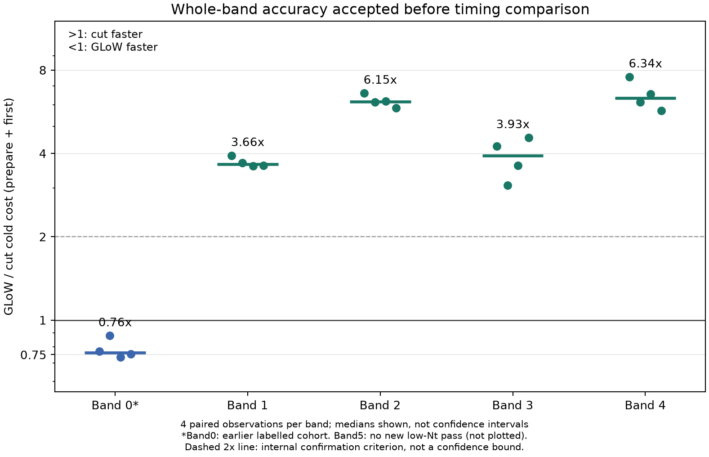

# NFW wave optics

**GPT-6.1sol Max & Hermes**

A direct frequency-domain evaluator for the standard untruncated, axisymmetric,
single-image Navarro–Frenk–White lens. An explicit modified-Bessel endpoint term
is combined with a complete complex Gaussian-carrier line on the correct
potential sheet. The numerical integrand retains the full potential exponential
and evaluates the weak complex diffraction residual directly.

- [Paper and PDF](https://explosion-awas.github.io/papers/nfw-wave-optics/)
- [Research paths and numerical lessons](https://explosion-awas.github.io/writing/nfw-wave-optics-lessons/)
- [中文论文入口](https://explosion-awas.github.io/zh/papers/nfw-wave-optics/)
- [中文探索手记](https://explosion-awas.github.io/zh/writing/nfw-wave-optics-lessons/)

## Install

Python 3.11 or newer:

```bash
git clone https://github.com/Explosion-Awas/nfw-wave-optics.git
cd nfw-wave-optics
python -m venv .venv
# Activate the environment using your shell's usual command.
python -m pip install -r requirements-replay.txt
python -m pip install -e . --no-deps
```

The pinned file records the original numerical package versions. No native GLoW,
GSL, third-party source trees or downloaded literature are bundled.
A wheel install supplies only the evaluators; full saved-evidence replay requires a repository checkout.

## Evaluate a band

```python
import numpy as np
from nfw_frozen_cut.controlled_cut import ControlledCutNFW

# A pre-existing paper band: q = w*y, kappa_s = 0.183, y = 27.7.
y = 27.7
q = np.linspace(0.47, 5.3, 801)
lens = ControlledCutNFW(y=y, kappa_s=0.183)
result = lens.evaluate(q / y, atol=1e-8, band_rtol=0.01)
print(result.route, result.converged, result.band_relative_indicator)
F = result.value
R = result.residual
```

`result.error_estimate` and the band indicator are **empirical diagnostics**,
not proved bounds. Check `converged` and `warnings`. The controller tries
48/96 nodes, can refine to 192, then falls back to stabilized split-Hankel
quadrature. Its empirical box is `8 <= y <= 256`,
`0.03 <= kappa_s <= 0.7`, `0.3 <= abs(w)*y <= 12`; the implementation checks
single-image geometry. Band control requires positive increasing frequencies.

The convention is `exp(+i*w*T)`, `psi(0)=0`, with the exact minimum delay set to
zero. For a waveform convention `exp(-2*pi*i*f*t)`, apply the conjugate
response. Do not align away phase/time differences when checking the complete
complex field.

## Tests and saved-value replay

```bash
python -B -m pytest -q -W error
python -B examples/replay_paper.py
```

The public test selection exercises lens geometry, potentials, complete complex
fields, Born/image coefficients, residual quadrature and controller routing.
It excludes historical study command-line tests and machine-dependent native
GLoW tests. New public replay tests cover working-directory independence and
manifest path safety.

The replay reads the original saved fields, not synthetic examples: 408 point
samples plus six complete 801-frequency bands, 5214 frequency cases grouped
into 30 lens configurations. It checks all eight methods and 48 whole-band
metrics, and reconstructs the 16 saved paired cold ratios from preparation and
first-evaluation records. It performs no new reference integrations, solver
benchmarking or parameter search.

The six bands meet the paper's `1e-10` complete-complex and one-percent
integrated-residual targets with empirical reference margins. The separate
timing comparison uses `1e-8` plus one percent. On bands 1–4, paired median
GLoW/direct preparation-plus-first ratios are 3.66, 6.15, 3.93 and 6.34.
The manuscript also retains the band-0 cold outcome, the band-5 threshold
failure and the fixed-lens warm-FFT comparison. These are different from a
claim of universal speedup or measured end-to-end inference acceleration.



## Layout

| Path | Role |
| --- | --- |
| `phase2/frozen/cut_v1/nfw_frozen_cut/` | Frozen evaluator used for the paper |
| `src/nfw_wave/` | Lens geometry, image expansion and original analytical comparisons |
| `phase2/src/nfw_advanced/` | Development module names retained for original unit tests |
| `data/frozen/` | Original reference/cut/Born records, losslessly compressed |
| `data/baselines/` | Complete common-set complex fields and scored tables |
| `data/timing/` | Saved timing analyses, including non-winning outcomes |
| `paper/` | Signed manuscript source, PDF and offline HTML |
| `SOURCE_MANIFEST.json` | Source-to-public hashes and explicit transformations |

## Reuse and attribution

Code is MIT; the manuscript, original figures and numerical records are
CC BY 4.0. See [NOTICE.md](NOTICE.md) for the exact scope and third-party
exclusions. The paper is agent-generated research output, publicly posted as a
manuscript, not a journal-publication claim. The requested byline is
**GPT-6.1sol Max & Hermes**.

Corrections and reproducible counterexamples are welcome through GitHub issues.
